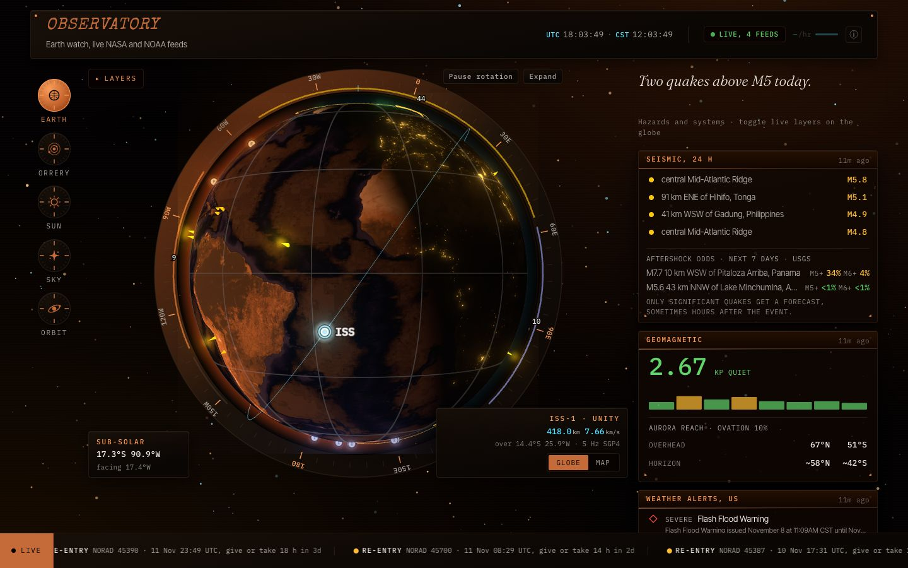
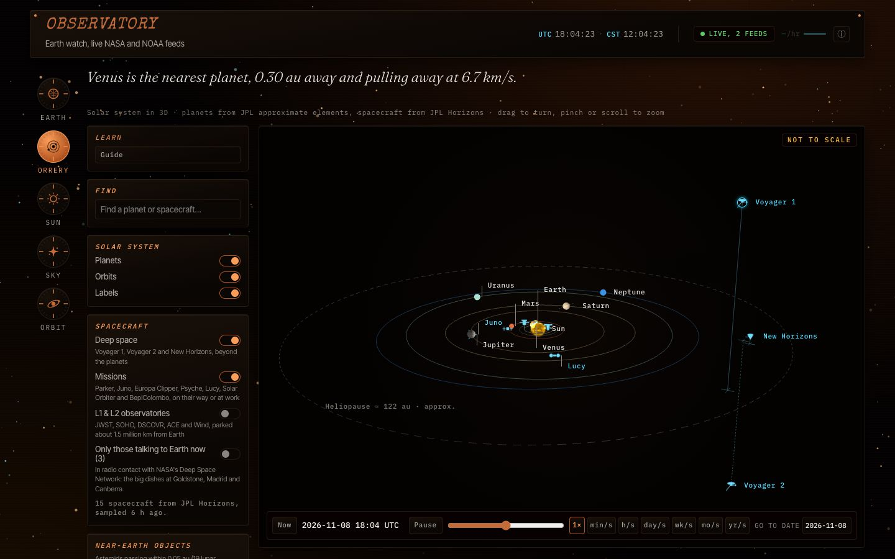
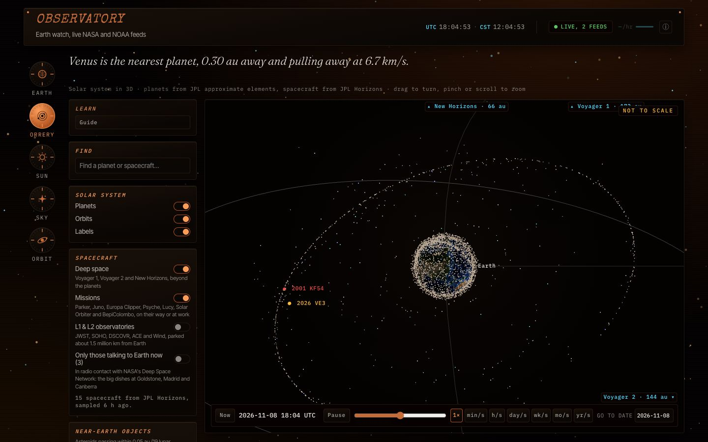
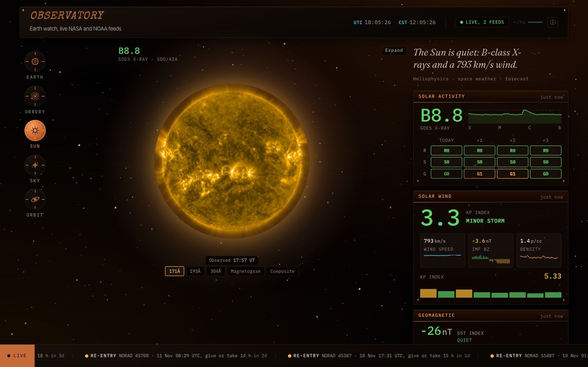
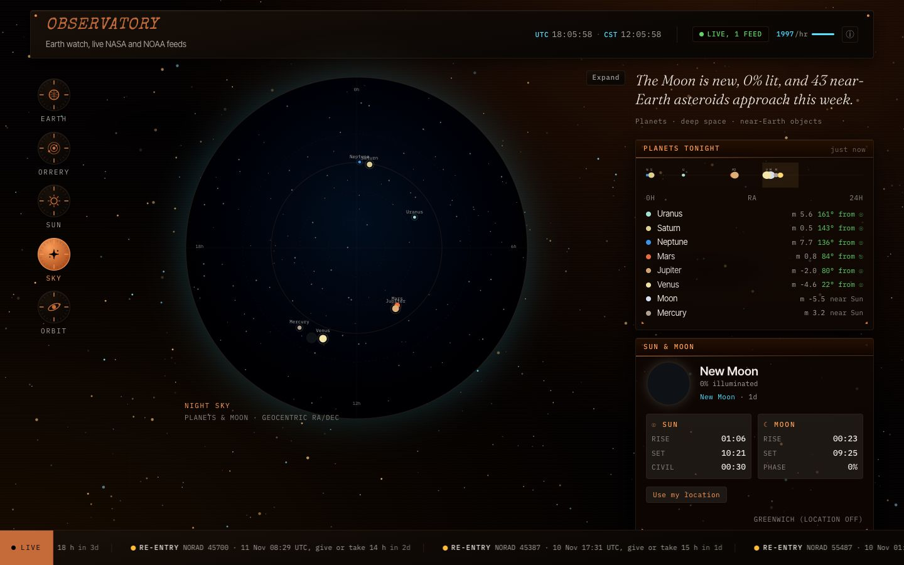
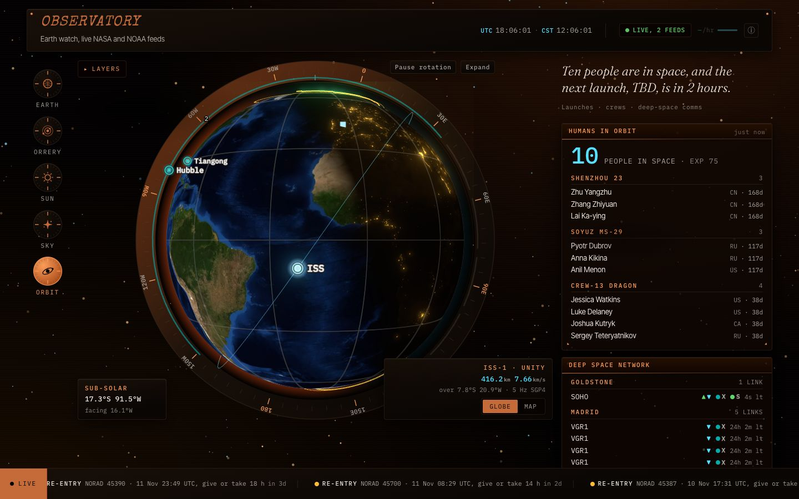
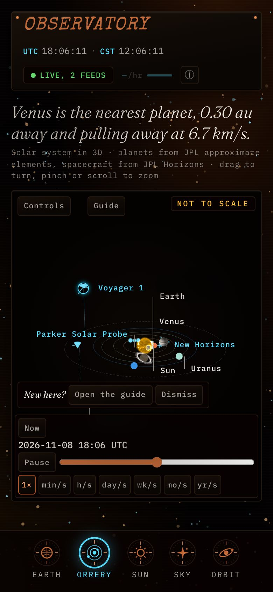

# Observatory: live NASA, NOAA and JPL space data, a 3D orrery and an ISS tracker

Observatory is a free, real-time space dashboard in the browser: an ISS and satellite tracker, a
3D orrery of the solar system, near-Earth asteroids and space weather. It puts quakes, fires and
natural events on a 3D globe and shows tonight's sky. The orrery draws the planets, major moons,
deep-space probes and passing asteroids, and you can scrub it through time.

**Live at [observatory.geektechlive.com](https://observatory.geektechlive.com)**



## What it shows

The dial on the left switches between five views. Each one opens with a sentence built from
the live data.

### Earth

A three.js globe (or a flat MapLibre map) with layers you can toggle: earthquakes from the USGS,
with aftershock odds for the strongest; NASA EONET natural events; GDACS disasters; NASA FIRMS
fires; OpenAQ air quality; NWS weather alerts; NOAA buoys; live aircraft; and the aurora oval
from NOAA's OVATION model. The ISS moves along its orbit in real time, propagated in the
browser. Beside it: today's quakes, the geomagnetic Kp index, weather alerts, NASA's EPIC image of
the whole Earth and the global CO₂ trend.

### Orrery



A full-page 3D solar system you can drag, zoom and run from 3000 BC to 3000 AD at up to a year a
second.

- **Planets** from JPL's approximate orbital elements, with real surface maps where they exist.
- **Spacecraft** from JPL Horizons: Voyager 1 and 2, New Horizons, Parker Solar Probe, Juno,
  Europa Clipper, JWST, SOHO and more. They show as silhouettes, and as NASA 3D models up close.
  The ones talking to the Deep Space Network right now are marked.
- **Major moons** of Mars, Jupiter, Saturn, Uranus and Neptune, and Earth's Moon.
- **Near-Earth asteroids** passing within 0.05 au this month (JPL CAD), with hazard flags, JPL
  Scout's unconfirmed objects and ESA's risk list.
- **Satellites:** about 19,500 tracked objects around Earth, as points close in and a haze
  farther out. A browser lists them by kind, orbit, launch, size, owner and predicted re-entry.
- **Search any small body** in JPL's database and draw its orbit.
- **Shareable links** that keep the date, the view and what you picked, and a built-in guide
  with hands-on lessons.



### Sun

The live Sun from NASA's Solar Dynamics Observatory at three wavelengths, as a magnetogram and as
a composite, plus SOHO's coronagraphs. Space weather from NOAA: X-ray flux and flares, the R/S/G storm scales with their
forecast, solar wind, the Kp and Dst indices, CME arrival forecasts, alerts and the solar cycle.



### Sky

The planets and Moon on a sky chart, rise and set times for your location (or Greenwich),
tonight's cloud cover, comets bright enough to find tonight, NASA's Astronomy Picture of the Day,
near-Earth asteroids this week, JPL Sentry's impact-risk list, recent fireballs, exoplanet
discoveries and the weather at Curiosity on Mars.



### Orbit

Who is in space right now, the ISS on the globe, the Deep Space Network's live links, the next
launches and space news.



It works on phones too: the dial becomes a bar at the bottom of the screen.



## Data sources and credits

Everything on the site comes from public data. Each source is credited below with a link, in the
wording its terms ask for, where they give one.

### NASA

- **[APOD, Astronomy Picture of the Day](https://science.nasa.gov/apod/)**, read from NASA
  Science, with the [NASA APOD API](https://api.nasa.gov/) as a fallback.
- **[NeoWs](https://api.nasa.gov/)**: near-Earth asteroids this week.
- **[DONKI](https://ccmc.gsfc.nasa.gov/tools/DONKI/)**: space weather events, from the
  Community Coordinated Modeling Center.
- **[EONET](https://eonet.gsfc.nasa.gov/)**: natural events (storms, volcanoes, wildfires, ice).
- **[EPIC](https://epic.gsfc.nasa.gov/)**: full-disc Earth images from DSCOVR.
- **[FIRMS](https://firms.modaps.eosdis.nasa.gov/)**: active fires from MODIS and VIIRS.
- **[GIBS](https://www.earthdata.nasa.gov/engage/open-data-services-software/earthdata-developer-portal/gibs-api)**:
  MODIS Terra true-colour map tiles, and the globe's Blue Marble and VIIRS Black Marble
  textures.
- **[Solar Dynamics Observatory](https://sdo.gsfc.nasa.gov/)**: AIA images and HMI
  magnetograms.
- **[SOHO LASCO](https://soho.nascom.nasa.gov/)** coronagraphs, from ESA and NASA's SOHO.
- **[Mars weather](https://science.nasa.gov/mission/msl-curiosity/)** from Curiosity's REMS instrument.
- **[Deep Space Network Now](https://eyes.nasa.gov/apps/dsn-now/)**: which spacecraft each dish
  is talking to.
- **[NASA Exoplanet Archive](https://exoplanetarchive.ipac.caltech.edu/)**: "This research has
  made use of the NASA Exoplanet Archive, which is operated by the California Institute of
  Technology, under contract with the National Aeronautics and Space Administration under the
  Exoplanet Exploration Program."
- **[NASA 3D Resources](https://science.nasa.gov/3d-resources/)**: the spacecraft models
  (Voyager, New Horizons, Parker Solar Probe, Juno, Europa Clipper, JWST, DSCOVR, ACE, SOHO,
  Wind), each credited in the site's inspector with the Source line of its model page.
- **Planet maps:** Mercury from MESSENGER MDIS (NASA/JHU APL/Carnegie Institution of
  Washington, mosaic by USGS Astrogeology); Mars from the Viking Orbiter MDIM 2.1 (NASA/JPL,
  mosaic by USGS Astrogeology); Jupiter from Cassini, PIA07782 (NASA/JPL/Space Science
  Institute); Earth from NASA Blue Marble.

NASA material is used as NASA's [media guidelines](https://www.nasa.gov/nasa-brand-center/images-and-media/)
ask: "NASA should be acknowledged as the source of the material." No NASA logos or insignia are
used.

### JPL Solar System Dynamics

- **[Horizons](https://ssd.jpl.nasa.gov/horizons/)**: positions of the planets, spacecraft,
  moons, asteroids and comets.
- **[Small-Body Database](https://ssd.jpl.nasa.gov/tools/sbdb_lookup.html)**: search, comet
  orbits and elements.
- **[CAD, close-approach data](https://cneos.jpl.nasa.gov/ca/)**,
  **[Scout](https://cneos.jpl.nasa.gov/scout/)**, **[Sentry](https://cneos.jpl.nasa.gov/sentry/)**
  and **[Fireballs](https://cneos.jpl.nasa.gov/fireballs/)**, from the Center for Near Earth
  Object Studies.
- **[Approximate positions of the planets](https://ssd.jpl.nasa.gov/planets/approx_pos.html)**
  (E. M. Standish): the orrery's planet orbits.

### NOAA

- **[Space Weather Prediction Center](https://www.swpc.noaa.gov/)**: GOES X-ray flux and
  flares, GOES SUVI images of the Sun, solar wind, the planetary Kp index and its forecast, the
  Dst index (from the World Data Center for Geomagnetism, Kyoto), the NOAA space weather scales,
  alerts, the solar cycle, WSA-ENLIL CME forecasts and the OVATION aurora model.
- **[National Weather Service](https://www.weather.gov/)**: active weather alerts.
- **[National Data Buoy Center](https://www.ndbc.noaa.gov/)**: latest buoy observations.
- **[Global Monitoring Laboratory](https://gml.noaa.gov/ccgg/trends/)**: atmospheric CO₂. Lan,
  X., Tans, P. and K.W. Thoning: Trends in globally-averaged CO2 determined from NOAA Global
  Monitoring Laboratory measurements. https://doi.org/10.15138/9N0H-ZH07

### ESA

- **[NEO Coordination Centre](https://neo.ssa.esa.int/)**: the risk list and upcoming close
  approaches.
- **[DISCOSweb](https://discosweb.esoc.esa.int/)**: mass, size and operator of satellites and
  spacecraft.

### Satellites and launches

- **[Space-Track.org](https://www.space-track.org/)**: re-entry predictions, the satellite
  catalogue (owner, launch, radar size), the box score and orbit history. Data from
  Space-Track.org, provided by USSPACECOM.
- **[CelesTrak](https://celestrak.org/)**: orbital elements for the ISS and every satellite group.
- **[RocketLaunch.live](https://www.rocketlaunch.live/)**: the launch schedule. Data by
  RocketLaunch.Live.
- **[International Space Station APIs](https://github.com/corquaid/international-space-station-APIs)**
  by corquaid (MIT): who is in space.
- **[Spaceflight News API](https://spaceflightnewsapi.net/)**: space news.

### Earth and sky

- **[USGS Earthquake Hazards Program](https://earthquake.usgs.gov/)**: earthquakes and
  aftershock forecasts.
- **[GDACS](https://www.gdacs.org/)**: global disaster alerts.
- **[OpenAQ](https://openaq.org/)**: air quality, from OpenAQ and its contributing data
  providers.
- **[adsb.lol](https://adsb.lol/)**: live aircraft positions (ODbL).
- **[Open-Meteo](https://open-meteo.com/)**: tonight's cloud cover. Weather data by
  Open-Meteo.com, under [CC BY 4.0](https://creativecommons.org/licenses/by/4.0/).
- **[US Naval Observatory](https://aa.usno.navy.mil/)**: sun and moon rise, set and phase.
- **[CARTO](https://carto.com/)** Dark Matter basemap: © [OpenStreetMap](https://www.openstreetmap.org/copyright)
  contributors, © [CARTO](https://carto.com/attribution/).
- **[Natural Earth](https://www.naturalearthdata.com/)** coastlines, through the
  [world-atlas](https://github.com/topojson/world-atlas) package. Made with Natural Earth.

### Images and type

- **Saturn, its rings and Neptune:** maps created by Björn Jónsson. The orrery uses them only as
  downscaled textures wrapped on the planets inside the 3D scene; this site does not offer them
  as maps. For the full, current maps, go to
  [his planetary maps page](https://bjj.mmedia.is/data/planetary_maps.html).
- **Fonts**, self-hosted: [Fraunces](https://fonts.google.com/specimen/Fraunces),
  [IBM Plex Mono](https://fonts.google.com/specimen/IBM+Plex+Mono) and
  [Inter Tight](https://fonts.google.com/specimen/Inter+Tight) under the SIL Open Font License,
  and [Special Elite](https://fonts.google.com/specimen/Special+Elite) under the Apache
  License 2.0.

## How it's built

- **Frontend:** Vite, React 19 and TypeScript. three.js draws the globe and the orrery, MapLibre
  GL the flat map, satellite.js runs SGP4 orbit propagation in the browser (in a Web Worker for
  the orrery's satellites), TanStack Query fetches, and Zod checks every response.
- **Hosting:** Cloudflare Pages, on the free plan by design. Pages Functions under `/api/*` call
  the upstream APIs, so API keys never reach the browser, and cache answers with the Cloudflare
  Cache API. An expired answer is served at once and refreshed in the background.
- **A scheduled refresh job** (GitHub Actions, every 6 hours) does the work that shouldn't happen on a request:
  it samples JPL Horizons and CAD, downloads the CelesTrak satellite groups, reads Space-Track
  and DISCOSweb with their accounts, and writes the results to Workers KV, which the Functions
  stream straight through.
- **One Durable Object** in its own Worker queues on-demand JPL searches, so visitors' lookups
  reach JPL one at a time, as its fair-use guidance asks.
- **Health checks:** every source has a content contract, so a feed that changes shape reads as
  an error, not as an empty "all clear". Outages open a GitHub issue per source and close it on
  recovery.

The details, and the decisions behind them, are in [docs/](docs/README.md): reference notes by
area and the [decision records](docs/decisions/README.md).

## Local development

Needs pnpm 12 (pinned in `package.json`) and Node 26, the version the refresh job runs on.

```bash
pnpm install

pnpm dev              # Vite dev server, without the Functions
pnpm build            # production build into dist/
pnpm pages:dev        # serves dist/ with the Pages Functions and KV (rebuild after edits)

pnpm lint             # ESLint (zero warnings) and stylelint
pnpm typecheck        # TypeScript
pnpm test:unit        # Vitest
pnpm test:e2e         # Playwright
pnpm verify           # the gate: all of the above, coverage, bundle budgets and pnpm audit
```

For the Functions, create `.dev.vars` (gitignored):

```
NASA_API_KEY=your_key_here
FIRMS_MAP_KEY=your_key_here
OPENAQ_API_KEY=your_key_here
```

More in [docs/operations/local-dev.md](docs/operations/local-dev.md), and how a change lands in
[docs/operations/landing.md](docs/operations/landing.md).

## Credits

Observatory began as a web port of **[cosmo-tui](https://github.com/irahulstomar/cosmo-tui)** by
[Rahul Tomar (@irahulstomar)](https://github.com/irahulstomar), a Python and Textual terminal
dashboard for NASA's open APIs. cosmo-tui showed that NASA's data could look good, and this site
takes that idea to the browser. It is a TypeScript rewrite, not a fork. No Python code was
copied. The credit also appears in the site's About popover and footer.

## License

MIT. See [LICENSE](LICENSE). cosmo-tui is also MIT licensed. Data, images and models belong to
their sources and are used under the terms credited above.
